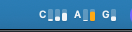
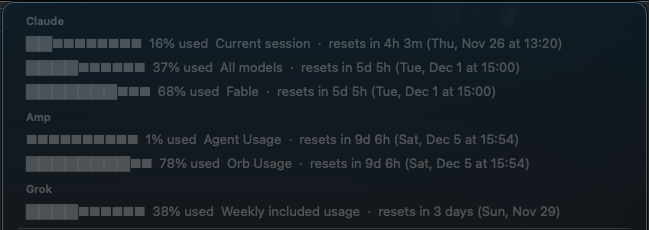

# UsageBar

**[usagebar.codeaz.org](https://usagebar.codeaz.org)** · a free tool from [CodeAZ](https://www.codeaz.org/)

A macOS menu bar app that shows how much of your Claude, Amp and Grok usage you have left.

It loads each provider's own usage page in a small floating window, reloads it on a timer, and draws the progress bars it finds as tiny meters in the menu bar. There are no API keys or tokens to set up: you sign in to each site once inside the window, the same way you would in a browser.

In the menu bar:



Click it for the details:



## Install

```sh
curl -fsSL https://usagebar.codeaz.org/install.sh | bash
```

This downloads the latest release into `/Applications` and opens it. More at [usagebar.codeaz.org](https://usagebar.codeaz.org).

## Build

Needs macOS 14 or later and the Xcode Command Line Tools (`xcode-select --install`).

```sh
git clone https://github.com/codeaz-org/UsageBar.git
cd UsageBar
./build.sh
```

This compiles `main.swift` into `UsageBar.app` next to the script and opens it. Sign in to each pane the first time; logins persist between launches.

## Use

- **Menu bar item:** one letter per site, then one vertical meter per usage bar on that page. Fuller means more used. Meters turn orange at 70% and red at 90%.
- **Menu:** the same readings as text, each with how long until it resets and when (if the page says), plus refresh interval, page zoom, keep-on-top and show/hide window.
- **↻ in a pane:** returns that pane to its usage page and reloads it. Automatic refreshes pause while you are elsewhere on the site, for example mid sign-in.

## Change the sites

Edit the `sources` array at the top of `main.swift` and rebuild. Any page that shows its usage with `role="progressbar"`, `role="meter"` or `<progress>` elements should work.

## Caveats

- The meters are read from each page's HTML. When a provider redesigns its usage page, the readings can break until the code is updated.
- The app sends a Safari user agent so sign-in pages accept the embedded web view. A provider can block that at any time.
- It reloads pages in your signed-in session on a timer. Check that this is fine under each provider's terms, and keep the interval reasonable.
- The app is not signed with a paid Apple developer certificate. If you download the zip through a browser, macOS blocks it until you allow it under System Settings, Privacy & Security. The install line above and building from source both avoid that.

This is a personal tool shared as-is, with no support promised.

## Made by CodeAZ

UsageBar is a free tool from [CodeAZ](https://www.codeaz.org/), a studio that makes websites and web apps.

[Website](https://www.codeaz.org/) · [Projects](https://www.codeaz.org/proiecte) · [Blog](https://www.codeaz.org/blog) · [YouTube](https://www.youtube.com/@codeaz95) · [More on GitHub](https://github.com/codeaz-org)

## License

MIT
